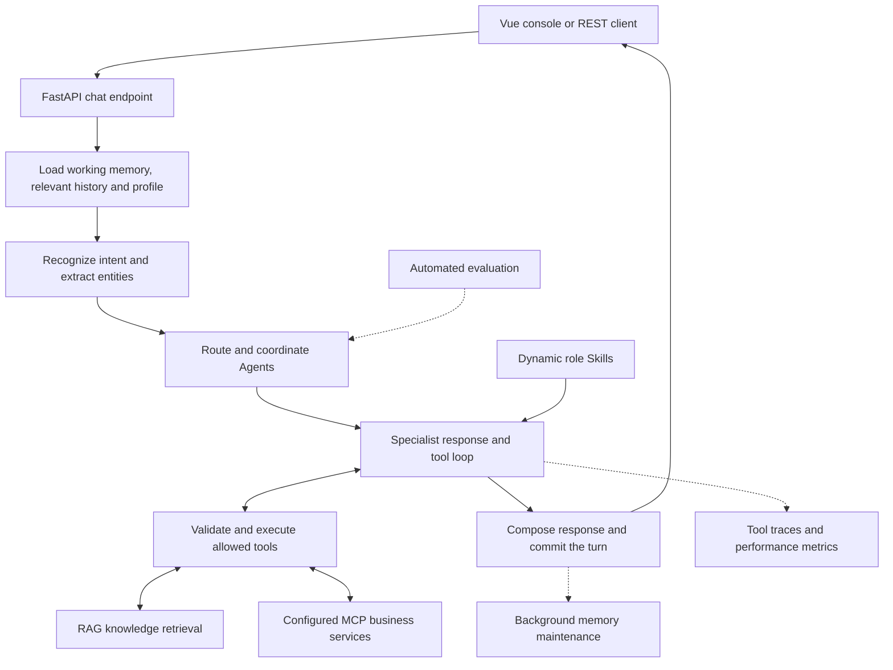

# SaaSBridge

**An observable, extensible customer support Agent Runtime.**

SaaSBridge is a Python runtime for intelligent customer support across B2B SaaS
and e-commerce scenarios, with a Vue support console. It coordinates specialized
Agents for general inquiries, technical troubleshooting and billing, combining
RAG, layered memory, dynamic Skills, validated tool calls, caching, graceful
degradation and automated evaluation in one request-processing workflow.

面向企业软件与电商场景的客服 Agent Runtime：将多 Agent 编排、RAG、分层记忆、动态 Skills、工具调用、缓存降级、自动化评测和可观测性整合在同一运行框架中。

The current product focus is **B2B SaaS**: API integration, feature questions,
onboarding, subscriptions and enterprise accounts. Foundational e-commerce
intents and support workflows remain available. Live order, payment, account
and ticket operations require an authorized business-system integration.

## Runtime capabilities

| Capability | Implemented behavior | Code |
| --- | --- | --- |
| Multi-agent orchestration | Intent routing, specialist selection, parallel collaboration, response composition and degraded-agent fallback | [Orchestrator](agents/agent_orchestrator.py) |
| RAG | ChromaDB retrieval, query rewriting, parallel recall, deduplication and reranking; OpenAPI JSON/YAML import with source/version metadata | [Knowledge base](tooling/knowledge_base.py), [retrieval pipeline](tooling/tool_manager.py), [OpenAPI importer](tooling/openapi_import.py) |
| Layered memory | Redis working memory, ChromaDB episodic memory and user profiles, conversation-state tracking and summary compression | [Memory manager](memory/conversation_memory.py) |
| Dynamic Skills | Role/keyword matching, prompt-budget limits and automatic refresh when skill files are added, edited or removed | [Skill loader](core/skill_loader.py), [role rules](skills/README.md) |
| Tool calling | Model-driven tool loops, JSON Schema validation, role allowlists, local diagnostic tools and configurable standard MCP connections | [Agent tools](agents/tools.py), [MCP client](tooling/mcp_client.py) |
| Caching and graceful degradation | TTL caches, cache invalidation, timeouts, circuit breakers, explicit tool fallbacks and Agent recovery routing | [Tool manager](tooling/tool_manager.py), [orchestrator](agents/agent_orchestrator.py) |
| Automated evaluation | Intent accuracy/Macro-F1, single- and multi-turn dialogue evaluation, LLM Judge, deterministic checks and baseline regression comparisons | [Evaluator](evaluation/evaluator.py), [evaluation jobs](evaluation/jobs.py) |
| Observability | Request IDs, routing reasons, tool traces, latency/success metrics, Prometheus export, alert rules and monitor-informed routing penalties | [Monitor](monitor/performance_monitor.py), [alert rules](config/alerts/saasbridge.yml) |

The runtime is exposed through FastAPI. The Vue console brings chat, knowledge
management, tool traces, evaluation and monitoring into the same interface.

## How a support turn runs



Conversation locking and request receipts protect turn handling and retries.
Potentially mutating tools carry retry-safety metadata; unknown write outcomes
are not automatically replayed. Business services remain responsible for their
own authorization, confirmation, transaction and idempotency guarantees.

## Support Agents

| Agent | Responsibilities | Typical intents |
| --- | --- | --- |
| `GeneralAgent` | General inquiries, clarification and initial triage | General queries and retained e-commerce support intents |
| `TechnicalAgent` | Application failures, login problems and diagnostic guidance | Technical/login/crash |
| `BillingAgent` | Billing, invoices, payment questions and subscription guidance | Billing/refund/invoice/payment, `subscription` |
| `APIAgent` | API documentation, authentication, error codes and safe debugging | `api_integration` |
| `OnboardingAgent` | Product features, initial configuration and guided setup | `feature_inquiry`, `onboarding` |
| `EnterpriseAgent` | Organization context, team roles, seats and contract-renewal guidance | `enterprise_mgmt` |
| `EscalationAgent` | Human handoff summaries for urgent or privileged requests | Explicit handoff and escalation |

English and Chinese intent examples and keyword patterns are included. Agent
replies follow the user's language. The roles share the selected model provider;
they do not require seven separately deployed models.

## Project layout

```text
SaaSBridge/
  agents/ core/ api/       Agent profiles, routing, Skills and FastAPI endpoints
  memory/ tooling/        Layered memory, RAG and tool/MCP execution
  evaluation/ monitor/    Evaluation jobs, regression baselines and telemetry
  skills/                 General and SaaS-specific support instructions
  frontend/               Vue support console
  config/                 MCP templates, Prometheus and alert configuration
  examples/               OpenAPI and product-knowledge templates
  docs/                   SaaS configuration and model-provider guidance
  tests/                  Backend regression tests
  compose.yaml            Redis and ChromaDB services
  compose.app.yaml        Application, console and optional monitoring
```

## Local setup (PowerShell, Python 3.12)

```powershell
cd D:\SaaSBridge
py -3.12 -m venv .venv
.\.venv\Scripts\python.exe -m pip install -r requirements-dev.txt
if (!(Test-Path .env)) { Copy-Item .env.example .env }
```

Choose a model provider in the private backend `.env`. The sample configuration
defaults to Qwen; the runtime also includes Anthropic-compatible, Groq and Hugging
Face adapters. See [model provider configuration](docs/MODEL_PROVIDERS.md) for
connection settings and checks. Provider availability, quotas and billing are
controlled by the provider account. Keep real keys out of Git and frontend settings.
If `py` is unavailable, use the full path to your installed Python executable.

Start Redis and ChromaDB with Docker Desktop running, then start the backend:

```powershell
docker compose up -d
.\.venv\Scripts\python.exe -m uvicorn api.main:app --host 127.0.0.1 --port 8000
```

Interactive API documentation: http://127.0.0.1:8000/docs

```powershell
Invoke-RestMethod http://127.0.0.1:8000/chat -Method Post -ContentType 'application/json' -Body '{"message":"Help me debug my API integration","user_id":"demo"}'
```

The first knowledge ingestion can download ChromaDB's embedding model.
On Windows the HTTP-only ChromaDB client avoids a native C++ build dependency;
the ChromaDB Docker service is required (local persistent fallback is unavailable).
External MCP connections and retail demo knowledge seeding are disabled by default.
Inherited `ECHOMIND_*` configuration names remain compatible with the upstream code.
The Compose file runs local development storage services; it is not a production deployment.

## Frontend

The Vue console includes chat, tool traces, knowledge search/import,
evaluation and monitoring details. With the Python backend running locally:

```powershell
cd D:\SaaSBridge\frontend
npm ci
npm run dev
```

Open http://127.0.0.1:5175. The frontend proxies `/api/python` to the backend on
port 8000. Model credentials belong in the backend `.env`; the connection dialog
accepts the backend's Bearer token when authentication is enabled.
Node.js 22.12+ or a supported newer release is needed by the supplied Vite version.

## Run the complete application with Docker

Create and configure `.env` from `.env.example`, then with Docker Desktop running:

```powershell
cd D:\SaaSBridge
docker compose -f compose.yaml -f compose.app.yaml up -d --build
```

Open http://127.0.0.1:5175. Backend API documentation remains available on port 8000.
Storage runs in named Docker volumes. The backend image downloads its embedding
model while building. This stack binds ports to localhost for development.

```powershell
docker compose -f compose.yaml -f compose.app.yaml down
```

The optional `--profile monitoring` starts the supplied Prometheus integration on
port 9090. Its scrape configuration assumes development mode; authenticated
production deployments need a dedicated metrics credential configuration.
Use the root Compose files for the SaaSBridge deployment.

## Product knowledge and OpenAPI

Supply your actual API documentation, feature release notes and integration FAQs.
No product capabilities, prices or contracts have been invented.

Upload an **OpenAPI 3.0/3.1 JSON or YAML** file from the knowledge panel or
`POST /knowledge/upload`. The console now accepts `.yaml` and `.yml` too.
Alternatively, convert a local spec into the existing knowledge API format:

```powershell
.\.venv\Scripts\python.exe -m tooling.openapi_import .\your-openapi.json .\data\openapi-documents.json
Invoke-RestMethod http://127.0.0.1:8000/knowledge/add -Method Post -ContentType 'application/json' -InFile .\data\openapi-documents.json
```

The converter includes operations, inherited authentication and server URLs, path
parameters and component definitions. Local path-item references are resolved;
other local references are validated and retained with component documents.
External references, YAML aliases and Swagger 2.0 require prior conversion.
Review documents for secrets before ingestion.
Import only trusted product documentation. The existing API limits apply to each
batch; split large payloads if necessary.

Other documentation uses the same endpoint:

```json
{"documents":[{"title":"Product release notes","content":"Your actual release notes here.","doc_type":"release_notes","source":"release-notes.md","product_version":"1.0"}]}
```

Document metadata is retained in search results. Reimporting the same OpenAPI
product/version/operation updates its chunks. Removed operations are not deleted
automatically; review obsolete documents before importing a replacement spec.

See [SaaS support configuration](docs/SAAS_SUPPORT.md) for the intent/agent map,
automatic Skill refresh, disabled external-system templates, working-memory TTL
and Prometheus alerts. Knowledge templates for release notes and integration
FAQs are in `examples/saas-knowledge.template.json`; replace placeholders before import.

## Evaluation and observability

The console can submit an evaluation job and poll its progress. The API exposes
`POST /eval/run` and `GET /eval/jobs/{job_id}`. Evaluation runs automatically after
it is triggered and compares compatible, valid suites against saved baselines.
Live model-based evaluation uses the selected LLM provider.

Evaluation uses separate routing state, tool caches and circuit breakers, and
excludes tools marked unsafe to retry. Its dialogue scope is the orchestrator;
HTTP reliability and storage behavior are covered separately by regression tests.
The job queue is process-local and does not survive a service restart. There is
currently no GitHub Actions workflow that runs these evaluations on every push.

| Endpoint | Purpose |
| --- | --- |
| `GET /monitor` | Agent/tool statistics, alerts and routing suggestions |
| `GET /trace/tool/{request_id}` | Trace of a particular request's tool calls |
| `GET /trace/tools` | Recent tool-call traces |
| `GET /metrics` | Prometheus metrics |
| `GET /skills` | Loaded Skills and parsing errors |
| `GET /integrations/mcp` | Configured MCP connection and tool status |

Metrics, traces and administrative endpoints follow the API access controls.
Prometheus rules cover service availability, chat HTTP errors and latency.
Notification delivery requires configuring a receiver; adding alert rules alone
does not send messages. See [SaaS support configuration](docs/SAAS_SUPPORT.md).

## Extending the runtime

1. Add an intent and bilingual examples in `core/intent_recognizer.py`.
2. Define an Agent profile and register its routing in `agents/agent_orchestrator.py`.
3. Add a role Skill in `skills/<scenario>/SKILL.md`; changes refresh on the next request.
4. Import verified product documents through `/knowledge/add` or `/knowledge/upload`.
5. Register a validated local tool or configure an allowlisted MCP service.
6. Add regression tests and evaluation cases for the scenario.

The disabled [MCP examples](config/mcp_saas.example.json) cover accounts,
subscriptions, tickets and documentation. Account services can require an
application-supplied user context; the remote service must enforce membership
and resource-level authorization. External operations remain disabled in the
sample configuration until explicitly connected.

## Tests

```powershell
.\.venv\Scripts\python.exe -m pytest -q
cd frontend
npm test
npm run build
```

The latest verified implementation baseline, `020fb79`, passed **235 backend
tests**, **14 frontend tests**, the frontend production build and Compose
configuration validation. These checks use mocked model providers and local
fixtures; they do not establish live-model answer quality or business-system
readiness. Documentation changes do not alter that measured baseline.

Coverage includes routing and collaboration, tool validation, failure handling,
request concurrency/idempotency, memory persistence, knowledge ingestion,
Skill refresh, MCP boundaries and evaluation behavior. SaaS-specific cases are
in `tests/test_saasbridge.py` and `tests/test_saas_extensions.py`.

## Current scope

SaaSBridge provides the runtime foundation and support console. Local tools
explain errors, validate supplied fields and perform limited calculations.
Actual order lookups, refunds, subscription changes, account-permission updates
and ticket creation require authorized business-system integrations. Human
handoff currently produces a summary; it does not create a live ticket.

The identity model is user-based and the local knowledge collection is shared.
Tenant-private contracts and account records require tenant-scoped storage and
authorization before a production multi-tenant deployment. Production API
authentication requires `ECHOMIND_ENV=production` and a valid
`ECHOMIND_API_TOKENS` mapping. Imported knowledge must be verified product
documentation; generic error-code mappings and example policies are not evidence
of a customer's actual account status.

Keep credentials in the local `.env`; publish only the empty configuration
template. Private reference archives, generated data and personal files are
excluded from version control. Commit attribution uses the project identity.

Source provenance: derived from the user-supplied Python EchoMind code. No new
license is asserted for that upstream material.
